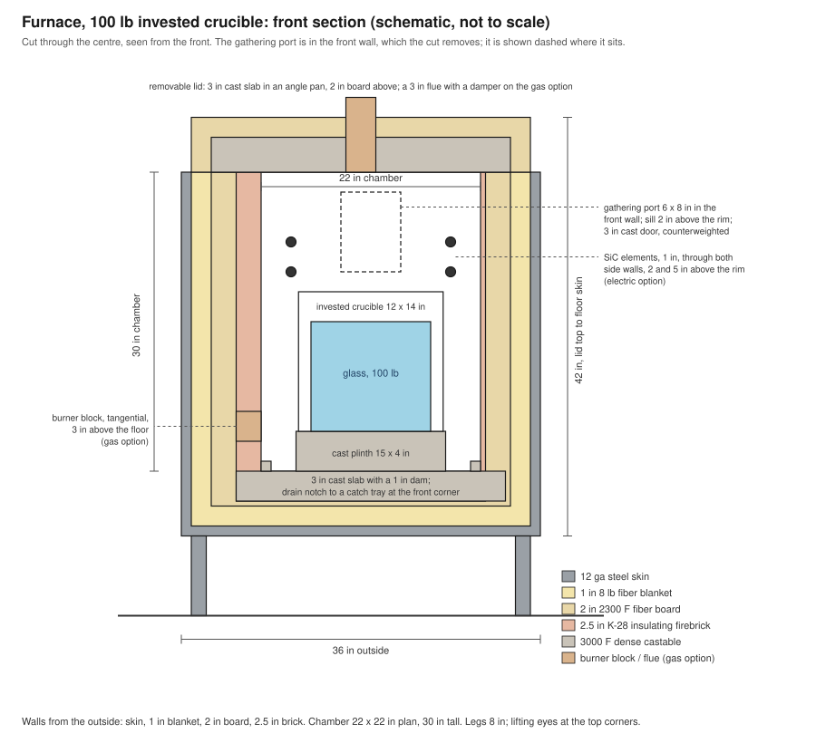
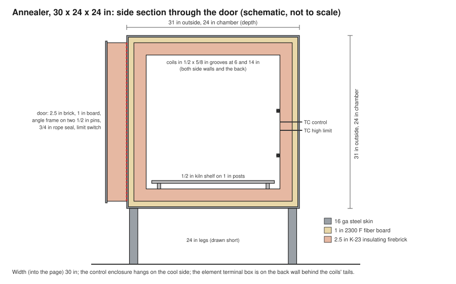
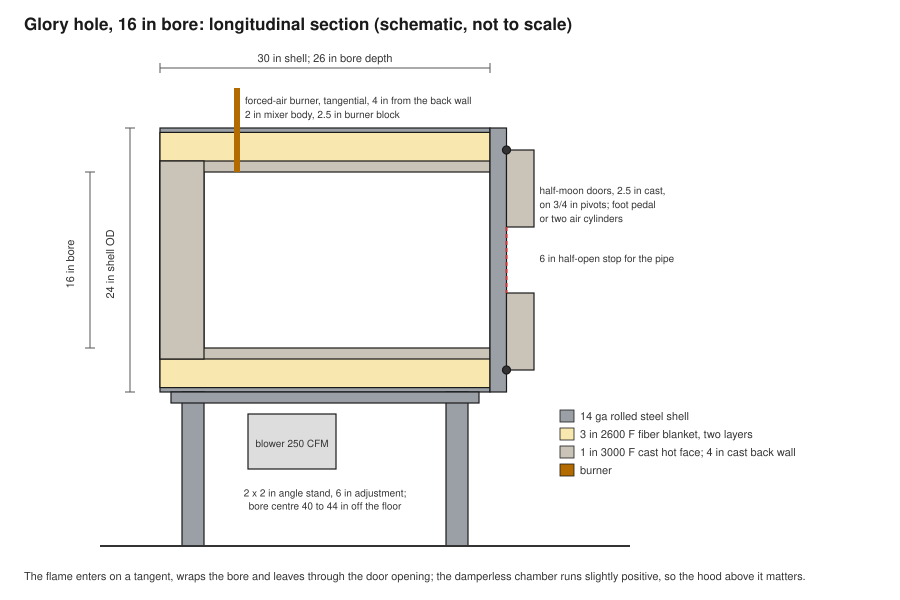

# Build the equipment: a furnace, an annealer and a glory hole

*Version 1, 5 November 2026. Generated from `deploy/shop-build/bom.json` by `scripts/build_shop_build.py`; the interactive version with option toggles is `/shop-build.html`. Edit the JSON, not this file.*

Three pieces of studio equipment drawn up for a do-it-yourself build by someone who can weld and fabricate, with every part that goes into them. Options cover the electrical service (240 V single-phase, the two-hot-leg service most buildings have, or three-phase at 208 V or 240 V) and the fuel (natural gas or propane for the glory hole and for the gas furnace). The designs follow the shop this site documents (an electric furnace on silicon-carbide elements with an SCR, a gas glory hole on forced air, electric annealers on a ramp-soak controller) and the published do-it-yourself lineage of studio glass equipment. Quantities, sizes and prices are planning figures; every gas and high-current electrical connection is designed and inspected by licensed people to the code in force where you build.

**Safety and code.** Nothing here is an engineering drawing or a permit set. Gas trains follow the National Fuel Gas Code (NFPA 54) and the furnace and oven standard (NFPA 86); electrical feeders and controls follow the National Electrical Code; both are installed and inspected by licensed people to the edition in force where you build. Where this document gives a number (an amperage, an orifice drill, a pipe size) it is the design figure for the professional to check, with the formula beside it.

## The options

**Electrical service.**

- 240 V single-phase: the ordinary two-hot-leg service (often called two-phase in a shop; it is one phase split in two); 208 V single-phase buildings follow the same parts with the 208 V arithmetic
- 208 V three-phase wye: 120/208 V, four-wire; coils and element strings can use 120 V line-to-neutral or 208 V line-to-line
- 240 V three-phase delta: three-wire delta, common in older industrial buildings; no neutral, so every load is line-to-line

**Fuel for the burners.**

- natural gas: low-pressure service at 7 inches of water column at the appliance; a 2 psi service needs a pounds-to-inches regulator at each appliance
- propane: 11 inches of water column at the appliance from a two-stage regulator at the tank; tank size is set by vaporization, not by volume

**How the furnace is heated.**

- electric, silicon-carbide elements
- gas, forced-air burner

## Sizing: the arithmetic the parts lists rest on

### Branch circuits

Current is P/V on single-phase and P/(√3·V) on three-phase; a furnace or annealer is a continuous load, so the breaker is the next standard size at or above 125% of it, and the copper conductor (THHN, 75 °C terminals) is the smallest whose ampacity covers the breaker, with 14, 12 and 10 AWG capped at 15, 20 and 30 A. The electric furnace is shown two ways: fed for the current new elements draw at the design power, or held to 80 A by the SCR's current limit (new elements then give about 9 kW until they age).

| Equipment | Service | Continuous amps | Breaker | Copper THHN |
|---|---|---|---|---|
| Furnace, electric, feeder sized for new elements at 12 kW | 240 V single-phase | 92.6 | 125 A | 1 AWG |
| Furnace, electric, SCR current limit set to 80 A | 240 V single-phase | 80.0 | 100 A | 3 AWG |
| Annealer, 7.2 kW | 240 V single-phase | 30.0 | 40 A | 8 AWG |
| Furnace, electric, feeder sized for new elements at 12 kW | 208 V three-phase wye | 65.5 | 90 A | 3 AWG |
| Annealer, 7.2 kW | 208 V three-phase wye | 20.0 | 30 A | 10 AWG |
| Furnace, electric, feeder sized for new elements at 12 kW | 240 V three-phase delta | 65.5 | 90 A | 3 AWG |
| Annealer, 7.2 kW | 240 V three-phase delta | 17.3 | 25 A | 10 AWG |

### Furnace elements

Silicon-carbide elements rise in resistance as they age, to about 3× when they are replaced. The strings are chosen so new elements reach the design power well below line voltage (the SCR holds them there) and old ones still reach it at full voltage. Example element resistance 1.4 Ω new (example value for a 1 in x 22 in hot zone silicon-carbide element; read the nominal resistance and tolerance from the element maker's sheet and recompute).

| Service | Strings | Elements | String Ω new | Volts for 12 kW, new | % of line | Line amps, new | kW at full voltage, end of life | SCR |
|---|---|---|---|---|---|---|---|---|
| 240 V single-phase | two series pairs in parallel (2S2P) | 4 | 2.80 | 130 V | 54% | 93 A | 13.7 kW | single-phase phase-angle SCR, 100 A, with current limit set to 100 A |
| 208 V three-phase wye | six elements, three series pairs in delta | 6 | 2.80 | 106 V | 51% | 65 A | 15.5 kW | three-phase phase-angle SCR, 80 A, with current limit |
| 240 V three-phase delta | six elements, three series pairs in delta | 6 | 2.80 | 106 V | 44% | 65 A | 20.6 kW | three-phase phase-angle SCR, 80 A, with current limit |

### Annealer coils

Coil length is resistance divided by the alloy's ohms per foot (iron-chrome-aluminium (Kanthal A-1 class, resistivity 1.45 ohm mm2/m) resistance per foot at room temperature; the alloy rises about 4 percent hot, which the relays absorb); the watt loading on the wire surface is kept at or under 22 W/in² so the coils last years at annealing temperature.

| Service | Coils | Ω each | Wire | Feet per coil | Feet total | Volts per coil | Watts per coil | W/in² | Total kW |
|---|---|---|---|---|---|---|---|---|---|
| 240 V single-phase | four 8 ohm coils, two series pairs in parallel | 8 | 14 AWG | 38 | 151 | 120 | 1800 | 19.8 | 7.2 |
| 208 V three-phase wye | three 6 ohm coils in wye, 120 V each | 6 | 12 AWG | 45 | 135 | 120 | 2404 | 17.6 | 7.2 |
| 240 V three-phase delta | three 24 ohm coils in delta, 240 V each | 24 | 16 AWG | 71 | 213 | 240 | 2400 | 17.6 | 7.2 |

### Burner orifices

Q (CFH) = 1658.5 · A (in²) · 0.9 · √(h ÷ SG), with h the manifold pressure in inches of water column and SG the gas's specific gravity (natural gas 0.60 at 1,000 BTU/ft³, propane 1.52 at 2,500 BTU/ft³). Drill the spud to the size shown, keep the one below in the drawer, and set the final size by the flame with a manometer on the test tee.

| Fuel | Burner | BTU/h | CFH | Manifold | Orifice diameter | Drill | One below |
|---|---|---|---|---|---|---|---|
| natural gas | Glory hole at full fire | 250,000 | 250 | 7 in WC | 0.250 in | E (0.2500 in) | C |
| natural gas | Glory hole at idle | 100,000 | 100 | 7 in WC | 0.158 in | #20 (0.1610 in) | #22 |
| natural gas | Gas furnace at full fire | 180,000 | 180 | 7 in WC | 0.212 in | #3 (0.2130 in) | #5 |
| natural gas | Gas furnace at idle | 90,000 | 90 | 7 in WC | 0.150 in | #22 (0.1570 in) | #25 |
| propane | Glory hole at full fire | 250,000 | 100 | 11 in WC | 0.178 in | #13 (0.1850 in) | #16 |
| propane | Glory hole at idle | 100,000 | 40 | 11 in WC | 0.113 in | #32 (0.1160 in) | #36 |
| propane | Gas furnace at full fire | 180,000 | 72 | 11 in WC | 0.151 in | #22 (0.1570 in) | #25 |
| propane | Gas furnace at idle | 90,000 | 36 | 11 in WC | 0.107 in | #32 (0.1160 in) | #36 |

### Gas pipe

Schedule 40 steel, natural gas 0.6 specific gravity, 0.5 inch water column drop, from the National Fuel Gas Code sizing table; verify against the edition in force. Capacity in cubic feet per hour (1,000 BTU/ft³ for natural gas); propane at 11 in WC uses the code's propane table and carries more BTU per pipe size.

| Pipe size | 10 ft | 20 ft | 40 ft | 60 ft | 100 ft |
|---|---|---|---|---|---|
| 3/4 in | 278 | 190 | 131 | 105 | 80 |
| 1 in | 520 | 357 | 246 | 197 | 150 |
| 1-1/4 in | 1,070 | 736 | 505 | 406 | 309 |
| 1-1/2 in | 1,600 | 1,100 | 757 | 608 | 463 |
| 2 in | 3,090 | 2,120 | 1,460 | 1,170 | 891 |

Examples: a glory hole alone (250 CFH) is a 1 in line to 20 ft and 1-1/4 in to 40 ft; a glory hole and a gas furnace (430 CFH) is 1-1/4 in to 40 ft and 1-1/2 in to 60 ft; the whole shop at 500 CFH is 1-1/4 in to 40 ft and 2 in to 100 ft.

### Propane supply

A tank vaporizes propane only as fast as the air warms its wetted wall. As a planning rule (supplier charts govern): a 120 gal tank half full gives about 100,000 BTU/h at 20 F and 200,000 at 60 F; a 500 gal tank half full about 300,000 at 20 F and 600,000 at 60 F; a 1,000 gal tank roughly double. A gas furnace plus a glory hole in a cold climate is a 1,000 gal tank or a 500 gal tank with an electric vaporizer.

## Furnace, 100 lb invested crucible

A square, top-and-front-loading pot furnace: a 100 lb invested (fused-silica) crucible on a cast plinth inside a chamber 22 by 22 inches in plan and 30 inches tall, 2,800 F insulating firebrick hot face backed by fiber board and blanket, a cast refractory floor that can hold a lost pot, a 6 by 8 inch gathering port with a counterweighted cast door, and either four silicon-carbide elements through the side walls above the pot or a single forced-air burner firing tangentially at floor level with a damped flue in the lid. It melts and holds 100 lb of soda-lime at 2,100 to 2,150 F, fines at 2,300 F, and idles on about 6 to 8 kW or 70 to 100 thousand BTU/h when well built.

**Design.**

| Part of the design | As drawn |
|---|---|
| crucible | invested fused-silica crucible, 100 lb, about 12 in inside diameter, 14 in tall, 14.5 in rim outside diameter; confirm the maker's drawing before casting the plinth |
| chamber | 22 x 22 in plan, 30 in tall; the crucible rim 18 in above the floor slab, the port sill 2 in above the rim, the elements 2 and 5 in above it; 3.5 in clearance pot to wall |
| walls | 2.5 in K-28 insulating firebrick (2,800 F) hot face, twelve courses, 2 in 2,300 F ceramic fiber board, 1 in 8 lb ceramic fiber blanket against the steel |
| floor | 3 in dense 3,000 F castable slab with a 1 in raised dam at the edges, over 2.5 in K-26 firebrick and 1 in fiber board; a 1 in drain notch at the front corner so a lost pot runs to a steel catch tray, not into the brick |
| plinth | cast 3,000 F dense castable disk, 15 in diameter, 4 in tall, with three 1 in setting feet so the pot sits level and air moves under the floor skin |
| roof | removable lid: 3 in cast 3,000 F castable slab in a 2 in angle pan, 2 in fiber board above it, lifting eyes; the gas option casts a 3 in flue with a sliding damper plate through it |
| port | 6 in wide x 8 in tall gathering port in the front wall, sill 2 in above the pot rim; a 3 in thick cast castable door block in a 1/4 in steel channel frame on a 1 in pivot pin, counterweighted to hang open or fall shut |
| shell | 2 x 2 x 3/16 in angle frame, 12 gauge skin, 1 in standoff air gap between skin and blanket at the sides for a cooler shell, legs 8 in, lifting eyes at the four top corners |
| outside | about 36 in wide, 36 in deep, 50 in tall to the lid top on 8 in legs, about 1,300 lb lined |
| electric | four silicon-carbide elements, 1 in diameter, 22 in hot zone, horizontal through the side walls 2 in above the pot rim (two per side), in two series pairs in parallel on single-phase or three series pairs in delta on three-phase, fed by a phase-angle SCR with a current limit, a safety contactor, a high-limit controller and a door interlock |
| gas | one forced-air burner of 120,000 to 200,000 BTU/h entering tangentially 3 in above the floor at the back corner, a cast burner block, a 3 in flue in the lid with a damper, a flame safeguard with a UV scanner, a pilot, and a gas train to the National Fuel Gas Code |

### Steel and fabrication

| Item | Qty | Spec | Applies to | Where | USD, planning |
|---|---|---|---|---|---|
| Angle, 2 x 2 x 3/16 in, A36 | 56 ft | frame: four 52 in uprights, top and bottom rectangles 36 x 36, four mid rails, lid pan 36 x 36, door frame stock. cut list in the build notes; order 10 percent over | all | steel yard | 220 to 300 |
| Sheet, 12 gauge (0.105 in) mild steel | 2 4 x 8 ft sheets | skin for four sides and the lid top; the floor pan from the drop | all | steel yard | 240 to 320 |
| Plate, 1/4 in, 12 x 24 in | 1 piece | door channel frame, counterweight arm plates, pivot bosses, lifting eye pads | all | steel yard | 40 to 60 |
| Flat bar, 1/4 x 2 in | 10 ft | port surround, lid pan lip, element guard brackets | all | steel yard | 25 to 40 |
| Round bar, 1 in, 1045 or 4140 | 2 ft | door pivot pin and counterweight arm pivot | all | steel yard | 20 to 35 |
| Pipe, 2 in schedule 40 | 4 ft | counterweight arm; also the flue sleeve on the gas option | all | steel yard | 25 to 40 |
| Expanded metal, 3/4 in #9, or perforated sheet | 1 4 x 4 ft | element terminal guards (electric) or burner guard (gas) | all | steel yard | 50 to 80 |
| Lifting eyes, 1/2 in forged, rated 1 ton | 4 each | top corners for moving the furnace by hoist | all | industrial supply | 30 to 50 |
| Leveling feet, 3/4 in threaded, 1,000 lb | 4 each |  | all | industrial supply | 40 to 70 |
| Welding consumables | 1 lot | ER70S-6 MIG wire or 7018 rod, gas, grinding discs, primer-free high-temperature paint (1,200 F) for the skin | all | welding supply | 80 to 140 |

### Refractory and insulation

| Item | Qty | Spec | Applies to | Where | USD, planning |
|---|---|---|---|---|---|
| Insulating firebrick, K-28 (2,800 F), 9 x 4.5 x 2.5 in | 160 bricks | hot-face walls: four walls x twelve courses x three bricks, plus cuts. K-26 is cheaper and holds up at 2,150 F; K-28 for the element zone and the fining excursions to 2,300 F | all | refractory distributor or kiln-parts supplier | 1,450 to 2,000 |
| Insulating firebrick, K-26 (2,600 F), 9 x 4.5 x 2.5 in | 40 bricks | floor backup course under the cast slab, and the lid's brick ring | all | refractory distributor | 280 to 400 |
| Dense castable, 3,000 F, high alumina (60 percent class) | 6 55 lb bags | floor slab with dam (3 bags), plinth (1), door block and sill (1), spare and burner block (1). mix with the maker's water ratio by weight, vibrate, cure 24 h damp, dry out on the schedule in the build notes | all | refractory distributor | 330 to 480 |
| Ceramic fiber board, 2,300 F, 2 in, 24 x 36 in | 9 sheets | wall backup (seven), lid (one), floor (one) | all | refractory distributor | 540 to 780 |
| Ceramic fiber blanket, 2,300 F, 8 lb/ft3, 1 in x 24 in x 25 ft | 1 roll | against the skin on all sides and under the lid pan | all | refractory distributor | 110 to 170 |
| Fiber rigidizer, colloidal silica | 1 gallon | paint every exposed fiber face so it does not shed | all | refractory distributor | 40 to 70 |
| High-temperature air-set mortar, 3,000 F | 2 gallons | thin joints on the insulating firebrick; do not butter thick | all | refractory distributor | 60 to 100 |
| Hard firebrick, super-duty, 9 x 4.5 x 2.5 in | 8 bricks | sill and spill curb at the port, shims under the plinth | all | refractory distributor | 40 to 70 |
| Fiber gasket rope, 3/4 in, 2,300 F | 15 ft | lid seat and door seat | all | refractory distributor | 30 to 50 |
| Refractory anchors, 310 stainless, 3 in V-anchors | 24 each | welded to the lid pan and door frame before casting | all | refractory distributor | 50 to 90 |
| Form materials for casting | 1 lot | melamine-faced board, sonotube 15 in for the plinth, wax or release, duct tape, a 3 in pipe plug for the flue (gas option) | all | lumber yard | 60 to 110 |

### Heat source: silicon-carbide elements (electric, silicon-carbide elements only)

| Item | Qty | Spec | Applies to | Where | USD, planning |
|---|---|---|---|---|---|
| Silicon-carbide heating element, 1 in diameter, 22 in hot zone, about 36 in overall, with cold ends | 4 each | straight rod with cold ends through the walls; order with the maker's terminal straps and clamps; note the nominal resistance on the packing slip, it sets the SCR setpoints. two spares on the shelf are wise; elements age by resistance and are replaced as a matched set | 240 V single-phase | element maker or kiln-parts distributor | 1,000 to 1,700 |
| Silicon-carbide heating element, 1 in diameter, 22 in hot zone, about 36 in overall, with cold ends | 6 each | three series pairs, one pair per phase, through both side walls and the back wall | 208 V three-phase wye, 240 V three-phase delta | element maker or kiln-parts distributor | 1,500 to 2,500 |
| Element terminal straps, aluminized braid, with clamps | 12 each | two per element plus spares; the maker sells them for the element diameter | all | element maker | 120 to 200 |
| Alumina element sleeves, 1.25 in bore x 6 in | 8 each | one per wall penetration, set in the brick with a loose fit so the element can grow | 240 V single-phase | kiln-parts supplier | 80 to 140 |
| Alumina element sleeves, 1.25 in bore x 6 in | 12 each |  | 208 V three-phase wye, 240 V three-phase delta | kiln-parts supplier | 120 to 200 |
| High-temperature lead wire, 8 AWG nickel, mica and fiberglass insulated | 30 ft | from the SCR output terminal block to the element straps, inside the terminal guards | all | kiln-parts supplier | 120 to 200 |
| Ceramic standoff insulators and terminal blocks, 600 V, 100 A | 8 each | steatite or porcelain, on the shell behind the guards | all | industrial electrical supply | 60 to 110 |
| Element terminal guard boxes, ventilated | 2 each | fabricated from the expanded metal and angle; must stay ventilated, the cold ends run hot | all | made in the shop | made or on hand |

### Controls and power (electric) (electric, silicon-carbide elements only)

| Item | Qty | Spec | Applies to | Where | USD, planning |
|---|---|---|---|---|---|
| Phase-angle SCR power controller with current limit, single-phase, 100 A, 240 V | 1 each | 4 to 20 mA or 0 to 10 V command, current limit, soft start, heatsink and fan; mount in a ventilated control enclosure. the current limit is what lets new, low-resistance elements run on the same feeder as old ones | 240 V single-phase | controls distributor | 1,500 to 2,600 |
| Phase-angle SCR power controller with current limit, three-phase, 80 A | 1 each | three-leg control for a delta load, current limit, soft start | 208 V three-phase wye, 240 V three-phase delta | controls distributor | 2,600 to 4,500 |
| PID temperature controller, 1/16 DIN, analog output | 1 each | type S or K input, 4 to 20 mA output to the SCR, alarm relay, autotune. this site's example shop runs a Novus N480D; Watlow, Fuji and Omega equivalents exist | all | controls distributor | 220 to 420 |
| High-limit controller with independent thermocouple | 1 each | latching over-temperature limit that drops the safety contactor at 2,350 F; manual reset | all | controls distributor | 150 to 300 |
| Thermocouple, type S (platinum-rhodium), 24 in, in a closed-end alumina protection tube with a ceramic head | 2 each | one control, one limit, through the back wall above the pot rim; type K in a protection tube is cheaper and lasts a season at 2,100 F | all | thermocouple maker | 300 to 600 |
| Thermocouple extension wire, type S (or K), 20 AWG, high-temperature jacket | 30 ft |  | all | controls distributor | 40 to 90 |
| Safety contactor, 2-pole, 100 A, 240 V coil, definite purpose | 1 each | ahead of the SCR; opened by the high limit, the door interlock and the emergency stop | 240 V single-phase | industrial electrical supply | 90 to 180 |
| Safety contactor, 3-pole, 80 A, 240 V coil | 1 each |  | 208 V three-phase wye, 240 V three-phase delta | industrial electrical supply | 120 to 240 |
| Door interlock limit switch, roller lever, NEMA 4 | 1 each | on the gathering door; cuts the element circuit while the door is open, as the example shop does | all | industrial electrical supply | 40 to 90 |
| Emergency stop, 22 mm, maintained, with legend | 1 each |  | all | industrial electrical supply | 25 to 50 |
| Control transformer, 240 V to 120 V, 250 VA, fused | 1 each | powers the controllers, the contactor coil and the pilot lights | all | industrial electrical supply | 60 to 120 |
| Digital ammeter with current transformer | 1 each | on the SCR output; element aging shows up here first | all | controls distributor | 40 to 90 |
| Control enclosure, NEMA 12, 24 x 20 x 10 in, with louvers and fan | 1 each | the SCR dissipates about 1.5 percent of load as heat; mount it off the furnace, in cool air | all | industrial electrical supply | 250 to 450 |
| Terminal blocks, DIN rail, fuses, pilot lights, wire duct, labels | 1 lot |  | all | industrial electrical supply | 150 to 300 |

### Electrical feed (electric) (electric, silicon-carbide elements only)

| Item | Qty | Spec | Applies to | Where | USD, planning |
|---|---|---|---|---|---|
| Fused disconnect, 100 A, 2-pole, 240 V, with 100 A class J fuses | 1 each | within sight of the furnace | 240 V single-phase | electrical supply | 220 to 400 |
| Fused disconnect, 100 A, 3-pole, 240 V, with 80 A class J fuses | 1 each |  | 208 V three-phase wye, 240 V three-phase delta | electrical supply | 280 to 480 |
| Branch breaker in the panel | 1 each | sized from the sizing table on this page; the furnace is a continuous load | all | electrical supply | 60 to 200 |
| Feeder conductors, copper THHN, in conduit | 1 run | size from the sizing table; equipment ground to code; the run from panel to disconnect to enclosure. installed by a licensed electrician; the amperage on this page is the design figure the electrician checks | all | electrical supply | 200 to 600 |
| Conduit, fittings, strain reliefs, grounding lugs | 1 lot |  | all | electrical supply | 120 to 250 |

### Heat source: forced-air burner (gas) (gas, forced-air burner only)

| Item | Qty | Spec | Applies to | Where | USD, planning |
|---|---|---|---|---|---|
| Burner body: 1.5 in schedule 40 black pipe, 14 in, with a 1.5 in tee and a centered gas spud | 1 assembly | air enters the tee's run from the blower, gas through a 1/4 in pipe nipple down the centre to a drilled orifice spud 2 in behind the nozzle; a 1.5 in to 2 in reducer as the flame retention nozzle | all | plumbing supply, made in the shop | 60 to 120 |
| Orifice spud, brass, 1/4 in NPT, drilled | 3 each | drill size from the orifice table on this page for the fuel; buy blanks and drill three sizes to tune | all | burner parts supplier | 15 to 30 |
| Combustion air blower, forward-curved squirrel cage, 150 CFM at 1 in static, 1/4 hp, 115 V | 1 each | with a 4 in inlet, mounted off the furnace on a bracket, a flexible duct and a butterfly air valve at the burner | all | industrial supply | 150 to 350 |
| Butterfly air valve, 2 in, with locking quadrant | 1 each |  | all | industrial supply | 40 to 90 |
| Burner block, cast 3,000 F castable, 9 in cube with a 2.5 in bore flared to 3.5 in | 1 each | cast around a tapered form; sits in the back corner wall, bore tangential to the chamber | all | cast from the castable above | made or on hand |
| Flue: 3 in bore cast through the lid, 2 in pipe damper plate, 1/4 in | 1 assembly | a sliding plate on two studs over the flue; the damper sets the chamber pressure slightly positive | all | made in the shop | 30 to 60 |
| Pilot burner, 1/4 in natural-draft, with target | 1 each | standing pilot proved by the flame safeguard or by a thermocouple pilot valve | all | burner parts supplier | 60 to 140 |
| Spark igniter, 6,000 V transformer, and electrode | 1 each |  | all | burner parts supplier | 80 to 160 |

### Gas train (gas) (gas, forced-air burner only)

| Item | Qty | Spec | Applies to | Where | USD, planning |
|---|---|---|---|---|---|
| Manual shutoff valve, 3/4 in, gas-rated ball valve, lockable | 2 each | one at the wall, one at the burner | all | plumbing supply | 40 to 80 |
| Sediment trap (drip leg), 3/4 in | 1 each |  | all | plumbing supply | 15 to 30 |
| Appliance pressure regulator, 3/4 in, natural gas, 7 in water column outlet | 1 each | vent-limited, sized for 200,000 BTU/h; a pounds-to-inches regulator if the building runs 2 psi | natural gas | plumbing supply | 60 to 140 |
| Two-stage propane regulation: first stage at the tank to 10 psi, second stage to 11 in water column at the appliance | 1 set | sized by the supplier for the whole shop's BTU/h; an appliance regulator at the furnace for 200,000 BTU/h | propane | propane supplier | 120 to 300 |
| Safety shutoff valve, electric, 3/4 in, 120 V, normally closed | 1 each | held open only while the flame safeguard proves flame | all | burner parts supplier | 120 to 260 |
| Flame safeguard relay with UV scanner | 1 each | proves pilot and main flame, trial-for-ignition timing, lockout on flame failure; the piece that makes an unattended furnace defensible. a thermocouple-type pilot safety valve is the minimum alternative on a furnace someone watches | all | burner parts supplier | 600 to 1,100 |
| Low and high gas pressure switches | 2 each |  | all | burner parts supplier | 150 to 300 |
| Pressure gauge, 0 to 15 in water column, and a test tee with a plugged tap | 1 each |  | all | burner parts supplier | 40 to 80 |
| Gas needle valve, 1/2 in, for the main burner trim | 1 each |  | all | burner parts supplier | 40 to 90 |
| Flexible gas connector, 3/4 in, stainless, listed for the fuel | 1 each |  | all | plumbing supply | 30 to 70 |
| Black pipe, 3/4 in, fittings, pipe dope rated for the fuel, pipe stands | 1 lot |  | all | plumbing supply | 80 to 200 |
| Combustion air proving switch (differential pressure) on the blower | 1 each | no air, no gas | all | burner parts supplier | 60 to 120 |
| Burner control enclosure, 120 V, with the safeguard, switches, pilot lights and a timer | 1 lot |  | all | industrial electrical supply | 200 to 400 |
| PID temperature controller and type S or K thermocouple with protection tube | 1 set | modulates a motorized gas butterfly or, simply, stages high and low fire through the safeguard | all | controls distributor | 500 to 900 |

### Crucible and furnace furniture

| Item | Qty | Spec | Applies to | Where | USD, planning |
|---|---|---|---|---|---|
| Invested fused-silica crucible, 100 lb | 1 each | plus one spare; the maker's pre-heat schedule governs the first fire | all | crucible maker | 900 to 1,600 |
| Charging scoop and ladle, stainless, long handle | 1 set |  | all | glass supplier | 80 to 160 |
| Steel catch tray, 1/8 in, 30 x 30 x 3 in, with sand | 1 each | under the drain notch; a lost pot goes here | all | made in the shop | 40 to 80 |
| Door counterweight, 25 lb steel or lead | 1 each |  | all | scrap yard | 30 to 60 |

**Planning totals for the parts above** (the fabrication labour is yours; prices are 2026 ranges from the kinds of suppliers named):

- electric, 240 V single-phase: 9,655 to 16,445 USD
- gas, natural gas (any service): 7,180 to 12,075 USD
- gas, propane (any service): 7,240 to 12,235 USD
- electric, 208 V three-phase wye: 11,385 to 19,345 USD
- electric, 240 V three-phase delta: 11,385 to 19,345 USD

**Build notes.**

1. Weld the base rectangle and uprights square and flat; the brick lining does not forgive a racked box. Set the leveling feet before anything goes inside.
2. Lay 1 in blanket against the skin, then the 2 in board, then the brick, course by course with thin mortar joints and staggered bonds; cut the element sleeve holes (electric) or the burner block pocket (gas) as the courses reach them, not afterwards.
3. Cast the floor slab in place over the board and backup brick with its dam and drain notch, vibrating out the air; cast the plinth, the door block and the lid slab in forms the same day. Keep every casting damp under plastic for 24 hours.
4. Dry the castables on the furnace's own first fire: 50 F an hour to 250 F and hold 6 hours, 50 F an hour to 500 F and hold 6 hours, then 100 F an hour to 1,000 F, then to working temperature. Steam that cannot escape spalls the slab; patience is cheaper than castable.
5. Electric: set the elements in their sleeves with 1/2 in of free length outside each wall, straps on the cold ends, leads in the guards; check each string's cold resistance with a meter and record it on the inside of the enclosure door with the date.
6. Gas: fire the burner first outside the furnace into open air, set the orifice and air for a blue flame with a short yellow tip, then into the block; the damper is set so a match flame at the port leans gently out.
7. First pot: follow the crucible maker's pre-heat, usually 50 F an hour to 1,000 F and 100 F an hour above it, with the pot empty; charge in 10 to 15 lb lots at 2,100 F or above, never into a cold pot, and fine at 2,300 F for six to eight hours before the first working day.

## Annealer, 30 x 24 x 24 in front loader

A front-loading electric annealer with a 30 in wide, 24 in deep, 24 in tall chamber lined with 2.5 in insulating firebrick and 1 in fiber board, four coiled iron-chrome-aluminium elements in grooved brick on the side and back walls, a hinged brick door with a rope seal, a ramp-soak controller driving solid-state relays through a safety contactor with an independent high limit, and a door switch that cuts power. Rated 7.2 kW: it reaches 950 F in about an hour from cold with the shelf loaded and holds within 5 F. A 20 x 20 x 20 in version with the same parts at 4.8 kW is noted where the quantities differ.

**Design.**

| Part of the design | As drawn |
|---|---|
| chamber | 30 W x 24 D x 24 H in interior; a 1/2 in kiln shelf on 1 in posts as the floor; door on the 30 in face |
| walls | 2.5 in K-23 insulating firebrick (2,300 F) with 1 in 2,300 F fiber board behind, on all six faces; the lid the same |
| elements | four coils of 14 AWG iron-chrome-aluminium (Kanthal A-1 class) wire, each about 38 ft, 8 ohms, wound on a 1/2 in mandrel and stretched to 5 ft, laid in two grooves on each side wall and one on the back wall, held with ceramic pins |
| power | 7.2 kW at 240 V single-phase as two parallel strings of two series coils (30 A); on 208 V three-phase as three coils in wye, 6 ohms each in 12 AWG; on 240 V three-phase delta as three coils, 24 ohms each, in 16 AWG |
| door | 2.5 in brick in a welded 1.5 in angle frame, two 1/2 in pin hinges, two over-centre latches, 3/4 in fiber rope seal; a limit switch on the frame opens the control circuit when the door is open |
| shell | 1.5 x 1.5 x 1/8 in angle frame, 16 gauge skin, a 2 in air gap under the floor, 24 in legs so the shelf sits at waist height |
| controls | ramp-soak controller with eight segments or more (the example shop uses a Novus N20K48), one solid-state relay per switched leg on a finned heatsink, a 2- or 3-pole safety contactor, an independent high-limit controller set to 1,250 F with its own thermocouple, pilot lights and a door switch |
| outside | about 40 in wide, 34 in deep, 60 in tall on its legs; about 450 lb |

### Steel and fabrication

| Item | Qty | Spec | Applies to | Where | USD, planning |
|---|---|---|---|---|---|
| Angle, 1.5 x 1.5 x 1/8 in, A36 | 60 ft | frame 40 x 34 x 36 in box on four 24 in legs; door frame 33 x 27 in; lid frame | all | steel yard | 150 to 220 |
| Sheet, 16 gauge mild steel | 2 4 x 8 ft sheets | skin, lid top, door skin, element terminal box | all | steel yard | 160 to 240 |
| Flat bar, 3/16 x 1.5 in | 12 ft | door stops, latch keepers, hinge straps | all | steel yard | 20 to 40 |
| Round bar, 1/2 in | 2 ft | hinge pins | all | steel yard | 8 to 15 |
| Over-centre draw latches, heavy, zinc | 2 each |  | all | industrial supply | 20 to 40 |
| Caster set, 4 in, two locking, 300 lb each | 4 each | optional; an annealer that rolls can be loaded from the bench side | all | industrial supply | 60 to 120 |
| Welding consumables and 1,200 F paint | 1 lot |  | all | welding supply | 60 to 100 |

### Refractory and insulation

| Item | Qty | Spec | Applies to | Where | USD, planning |
|---|---|---|---|---|---|
| Insulating firebrick, K-23 (2,300 F), 9 x 4.5 x 2.5 in | 150 bricks | walls, floor, lid and door for the 30 x 24 x 24 chamber (about 130 laid plus cuts); the 20 in cube takes about 95 | all | refractory distributor | 600 to 900 |
| Ceramic fiber board, 2,300 F, 1 in, 24 x 36 in | 9 sheets | behind every brick face including the door and lid | all | refractory distributor | 300 to 450 |
| High-temperature air-set mortar, 2,600 F | 1 gallon |  | all | refractory distributor | 30 to 50 |
| Fiber gasket rope, 3/4 in, 2,300 F | 12 ft | door seal and lid seat | all | refractory distributor | 25 to 40 |
| Kiln shelf, cordierite, 1/2 in, two at 14 x 28 in | 2 each | the floor the glass sits on; plus 1 in posts | all | kiln-parts supplier | 120 to 200 |
| Kiln wash | 1 pint |  | all | kiln-parts supplier | 10 to 20 |
| Element groove: cut with a masonry blade, 1/2 in wide x 5/8 in deep | 1 note | two grooves per side wall and one across the back at 6 in and 14 in above the floor; corners rounded so the coil does not kink | all | done in the shop | made or on hand |

### Elements

| Item | Qty | Spec | Applies to | Where | USD, planning |
|---|---|---|---|---|---|
| Iron-chrome-aluminium resistance wire, 14 AWG (0.0641 in), Kanthal A-1 class | 1 5 lb spool | about 38 ft per 8 ohm coil, 152 ft for four (about 1.8 lb); wind on a 1/2 in mandrel and stretch to the groove length; 19.8 W/in2 on the wire | 240 V single-phase | kiln-parts supplier or alloy distributor | 100 to 190 |
| Iron-chrome-aluminium resistance wire, 12 AWG (0.0808 in), Kanthal A-1 class | 1 5 lb spool | about 45 ft per 6 ohm coil, 135 ft for three (about 2.5 lb) on 208 V wye; 17.5 W/in2 on the wire | 208 V three-phase wye | kiln-parts supplier or alloy distributor | 120 to 220 |
| Iron-chrome-aluminium resistance wire, 16 AWG (0.0508 in), Kanthal A-1 class | 1 5 lb spool | about 71 ft per 24 ohm coil, 213 ft for three (about 1.6 lb) on 240 V delta; 17.6 W/in2 on the wire; the thinner wire is the price of a delta service without a neutral | 240 V three-phase delta | kiln-parts supplier or alloy distributor | 100 to 190 |
| Element pins, Kanthal, 2 in | 60 each | one every 4 in of groove | all | kiln-parts supplier | 25 to 50 |
| Porcelain element connector blocks and ceramic tube bushings for the wall penetrations | 8 each |  | all | kiln-parts supplier | 40 to 80 |
| High-temperature lead wire, 10 AWG nickel, mica and fiberglass | 25 ft | from the SSRs to the element tails inside the terminal box | all | kiln-parts supplier | 60 to 120 |
| Element tail splice: twist and clamp with stainless crimps, never solder | 1 note |  | all | done in the shop | made or on hand |

### Controls and power

| Item | Qty | Spec | Applies to | Where | USD, planning |
|---|---|---|---|---|---|
| Ramp-soak controller, 1/16 DIN, type K input, relay or logic output, eight or more segments | 1 each | the example shop standardizes on the Novus N20K48 and reads it over Bluetooth with its own dashboard; Bartlett Genesis and Orton are the kiln-trade alternatives | all | controls distributor or kiln-parts supplier | 250 to 450 |
| Solid-state relay, 40 A, 48 to 480 V AC, 3 to 32 V DC control, zero-cross, on a finned heatsink with thermal paste | 2 each | one per hot leg so both legs open; 40 A relays at 30 A load run cool on a 1.0 C/W heatsink | 240 V single-phase | controls distributor | 80 to 160 |
| Solid-state relay, 25 A, zero-cross, on heatsinks | 3 each | one per phase leg; a three-phase SSR block is the tidy alternative | 208 V three-phase wye, 240 V three-phase delta | controls distributor | 90 to 180 |
| Safety contactor, definite purpose, 2-pole, 40 A, 120 V coil | 1 each | in series with the SSRs; opened by the high limit, the door switch and the emergency stop | 240 V single-phase | industrial electrical supply | 40 to 90 |
| Safety contactor, definite purpose, 3-pole, 40 A, 120 V coil | 1 each |  | 208 V three-phase wye, 240 V three-phase delta | industrial electrical supply | 50 to 110 |
| High-limit controller with its own type K thermocouple | 1 each | latching, manual reset, set at 1,250 F | all | controls distributor | 120 to 260 |
| Thermocouple, type K, 8 AWG, ceramic insulated, in a mullite protection tube, 12 in, with a head | 2 each | control and limit, through the back wall at mid-height, 4 in into the chamber | all | thermocouple maker or kiln-parts supplier | 60 to 140 |
| Type K extension wire, 20 AWG | 20 ft |  | all | controls distributor | 20 to 40 |
| Door limit switch, roller, and an emergency stop | 1 set |  | all | industrial electrical supply | 60 to 120 |
| Control transformer, 240 V to 120 V, 100 VA, fused | 1 each | not needed on 208 V wye, which has a neutral for 120 V | 240 V single-phase, 240 V three-phase delta | industrial electrical supply | 40 to 80 |
| Control enclosure, NEMA 1 or 12, 16 x 14 x 8 in, louvered | 1 each | on the cool side of the annealer, never on top | all | industrial electrical supply | 120 to 220 |
| Fused disconnect or breaker within sight, 2-pole 40 A or 3-pole 30 A | 1 each |  | all | electrical supply | 80 to 200 |
| Branch circuit: breaker and copper THHN in conduit, from the sizing table | 1 run | by a licensed electrician | all | electrical supply | 150 to 400 |
| Pilot lights (power, heating, limit tripped), terminal blocks, DIN rail, wire duct, labels | 1 lot |  | all | industrial electrical supply | 80 to 160 |

**Planning totals for the parts above** (the fabrication labour is yours; prices are 2026 ranges from the kinds of suppliers named):

- 240 V single-phase: 2,888 to 5,195 USD
- 208 V three-phase wye: 2,888 to 5,185 USD
- 240 V three-phase delta: 2,908 to 5,235 USD

**Build notes.**

1. Build the box, then dry-fit the brick before mortar: a 30 in wall is 3.33 bricks, so plan the cuts to land at the back corners where the grooves do not run.
2. Cut the element grooves with a diamond or masonry blade on a track; round every corner with a rasp so the coil lies without kinks. Pins go in after the coils, angled down, one every 4 in.
3. Wind coils on a 1/2 in rod in a drill at low speed, counting turns; cut to the measured resistance with a meter, not to length, since wire varies. Stretch each coil evenly to the groove length before laying it in; a bunched coil runs hot and fails there.
4. Wire the control circuit so that the high limit, the door switch and the emergency stop are all in series with the contactor coil: any one open and the elements are dead regardless of the controller.
5. First fire empty to 1,000 F over four hours with the door cracked an inch until 400 F to drive moisture out of the brick and mortar; let the controller autotune at 900 F with the shelf in.
6. Soda-lime annealing: hold at 900 to 960 F long enough for the thickest section (about an hour per half inch), then cool 50 to 100 F an hour to 700 F and 150 to 250 F an hour to 300 F; thick casting goes far slower. The controller's segments carry the schedule; the glass never meets a draft from an opened door above 400 F.

## Glory hole, 16 in bore, forced-air gas

A horizontal reheating chamber 16 in in diameter and 26 in deep: a 1 in cast 3,000 F hot face over 3 in of 2,600 F fiber blanket inside a 24 in diameter rolled steel shell, a cast back wall with a tangential burner port, a cast door ring with two half-moon doors on a foot-pedal pivot (pneumatic cylinders optional), on an adjustable stand. One forced-air burner of 150,000 to 250,000 BTU/h on natural gas at 7 inches of water column or propane at 11, a combustion air blower with a butterfly valve, a pilot, a flame safeguard and a gas train to the National Fuel Gas Code. It runs at 2,100 to 2,300 F and idles on about 100,000 BTU/h with the doors shut.

**Design.**

| Part of the design | As drawn |
|---|---|
| chamber | 16 in bore x 26 in deep; the burner enters tangentially 4 in from the back wall, the flame wraps the bore and exits the door opening |
| lining | 1 in dense 3,000 F castable hot face cast against a 16 in form, over two 1.5 in layers of 2,600 F 8 lb ceramic fiber blanket, rigidized; a cast 4 in back wall with the burner block cast in |
| shell | 24 in diameter x 30 in long, 14 gauge rolled and seam welded, or a 24 in tank section; 1/4 in end rings; 2 in angle saddles to the stand |
| doors | cast 3,000 F castable half-moon doors 2.5 in thick in 1/4 in steel frames, each on a 3/4 in pivot pin in bushings on the door ring, opened by a foot pedal through a linkage, or by two pneumatic cylinders on a foot valve as the example shop does; a 6 in half-open stop for the pipe |
| stand | 2 x 2 x 3/16 in angle, four legs with 6 in of height adjustment on 3/4 in threaded feet, bore centre set 40 to 44 in above the floor, a shelf for the blower |
| burner | forced-air: 2 in schedule 40 mixer body 12 in long with a 2 in tee, a 1/4 in gas spud centered, a flame-retention nozzle into a cast burner block with a 2.5 in bore; air from a 250 CFM blower through a 2 in butterfly valve; gas through a needle valve for trim |
| outside | about 26 in wide, 34 in deep with the door ring, 50 in tall on the stand; about 350 lb |

### Steel and fabrication

| Item | Qty | Spec | Applies to | Where | USD, planning |
|---|---|---|---|---|---|
| Shell: 14 gauge mild steel, rolled to 24 in diameter x 30 in long, seam welded | 1 each | have the steel yard roll it, or use a 24 in diameter pressure-tank section cut to length (de-gassed and cleaned) | all | steel yard | 150 to 350 |
| End rings, 1/4 in plate, 24 in OD x 17 in ID (front) and 24 in disc (back) with a 3 in burner port cut | 2 each | water-jet or plasma cut; the front ring carries the door pivots | all | steel yard or fabricator | 120 to 220 |
| Door frames, 1/4 in x 2 in flat bar bent to a half-moon of 17 in, with pivot bosses | 2 each |  | all | steel yard, made in the shop | 60 to 120 |
| Door pivot pins, 3/4 in 4140, and bronze bushings | 2 sets |  | all | industrial supply | 40 to 80 |
| Angle, 2 x 2 x 3/16 in | 30 ft | stand, saddles, blower shelf, burner mount | all | steel yard | 120 to 170 |
| Threaded leveling feet, 3/4 in, 500 lb, and 3/4 in nuts welded in the legs | 4 each |  | all | industrial supply | 40 to 70 |
| Foot pedal, linkage rod 3/8 in, clevises, return spring, and a half-open stop | 1 set | the pedal opens both doors through a bell crank; a stop holds them 6 in apart for the pipe | all | industrial supply, made in the shop | 60 to 120 |
| Pneumatic door option: two 1.5 in bore x 4 in stroke cylinders, a 4-way foot valve, 1/4 in tubing, fittings, a filter-regulator | 1 set | runs on 60 to 90 psi shop air, as the example shop's doors do | all | industrial supply | 250 to 450 |
| Expanded metal heat shield over the door ring and a 1/8 in splash plate under the opening | 1 lot |  | all | steel yard | 40 to 80 |
| Welding consumables and 1,200 F paint | 1 lot |  | all | welding supply | 50 to 90 |

### Refractory and insulation

| Item | Qty | Spec | Applies to | Where | USD, planning |
|---|---|---|---|---|---|
| Dense castable, 3,000 F, high alumina | 4 55 lb bags | hot-face tube 1 in x 16 in bore x 26 in (about 1.5 bags), back wall with burner block (1), door ring and two doors (1.5) | all | refractory distributor | 220 to 320 |
| Ceramic fiber blanket, 2,600 F, 8 lb/ft3, 1.5 in x 24 in x 25 ft | 2 rolls | two layers around the hot face and behind the back wall; staggered seams. 2,600 F blanket, not 2,300 F: the bore runs hotter than a furnace wall | all | refractory distributor | 280 to 450 |
| Fiber rigidizer, colloidal silica | 1 gallon |  | all | refractory distributor | 40 to 70 |
| Refractory anchors, 310 stainless, V-anchors and door frame studs | 30 each |  | all | refractory distributor | 60 to 100 |
| Casting forms: 16 in sonotube (hot face), a tapered burner-block plug, door forms from melamine with a 2.5 in rim | 1 lot |  | all | lumber yard | 60 to 110 |
| Fiber gasket rope, 1/2 in, 2,300 F, for the door seats | 10 ft |  | all | refractory distributor | 20 to 35 |
| Spare castable for the door faces | 1 55 lb bag | door faces take the most abuse and get re-cast every year or two | all | refractory distributor | 55 to 80 |

### Burner and air

| Item | Qty | Spec | Applies to | Where | USD, planning |
|---|---|---|---|---|---|
| Burner body: 2 in schedule 40 black pipe, 12 in, with a 2 in tee, a 2 in to 2.5 in flame-retention nozzle (reducer), and a centered 1/4 in gas tube with the orifice spud 2.5 in behind the nozzle | 1 assembly |  | all | plumbing supply, made in the shop | 80 to 150 |
| Orifice spuds, brass, 1/4 in NPT, drilled to the table on this page | 3 each | three sizes bracketing the computed drill so the flame can be tuned | all | burner parts supplier | 15 to 30 |
| Combustion air blower, forward-curved squirrel cage, 250 CFM at 1 in static, 1/3 hp, 115 V, with a 4 in inlet | 1 each | on the stand's shelf, a 2 in flexible duct to the butterfly valve; the example shop's blower is in a closet outside with a duct along the wall, which keeps the noise out of the room | all | industrial supply | 200 to 400 |
| Butterfly air valve, 2 in, with a locking quadrant | 1 each |  | all | industrial supply | 40 to 90 |
| Combustion air proving switch on the blower outlet | 1 each |  | all | burner parts supplier | 60 to 120 |
| Pilot burner, 1/4 in, natural draft, with a target and a 3/16 in pilot line | 1 each |  | all | burner parts supplier | 60 to 140 |
| Spark igniter transformer and electrode, or a piezo pilot lighter | 1 each |  | all | burner parts supplier | 60 to 160 |
| Burner block: cast into the back wall, 2.5 in bore flaring to 3.5 in, tangential | 1 each |  | all | cast from the castable above | made or on hand |

### Gas train

| Item | Qty | Spec | Applies to | Where | USD, planning |
|---|---|---|---|---|---|
| Manual shutoff valves, 3/4 in gas ball valve, lockable | 2 each |  | all | plumbing supply | 40 to 80 |
| Sediment trap (drip leg), 3/4 in | 1 each |  | all | plumbing supply | 15 to 30 |
| Appliance regulator, 3/4 in, natural gas, 7 in water column outlet, vent-limited, 250,000 BTU/h | 1 each |  | natural gas | plumbing supply | 60 to 140 |
| Propane: two-stage regulation at the tank and an 11 in water column appliance regulator sized for 250,000 BTU/h | 1 set |  | propane | propane supplier | 120 to 300 |
| Safety shutoff valve, electric, 3/4 in, normally closed, 120 V | 1 each |  | all | burner parts supplier | 120 to 260 |
| Flame safeguard relay with UV scanner (or a thermocouple pilot safety valve as the minimum on an attended glory hole) | 1 each |  | all | burner parts supplier | 600 to 1,100 |
| Gas needle valve, 1/2 in, for the main trim | 1 each |  | all | burner parts supplier | 40 to 90 |
| Pressure gauge 0 to 15 in water column with a test tee | 1 each |  | all | burner parts supplier | 40 to 80 |
| Flexible gas connector, 3/4 in stainless, listed for the fuel | 1 each |  | all | plumbing supply | 30 to 70 |
| Black pipe 3/4 in, fittings, dope rated for the fuel, pipe stand | 1 lot |  | all | plumbing supply | 80 to 200 |
| Burner control box, 120 V: switches, the safeguard, pilot lights, a 15 A breaker | 1 lot |  | all | industrial electrical supply | 150 to 300 |
| Thermocouple, type K in a protection tube, and a readout (the glory hole is run by eye, but a reading at the back wall is worth having) | 1 set |  | all | controls distributor | 80 to 200 |

**Planning totals for the parts above** (the fabrication labour is yours; prices are 2026 ranges from the kinds of suppliers named):

- natural gas: 3,435 to 6,555 USD
- propane: 3,495 to 6,715 USD

**Build notes.**

1. Roll or cut the shell, weld the back disc with its burner port and the front ring; weld the anchors to the inside before any blanket goes in.
2. Lay the blanket in two layers with staggered seams, then set the 16 in sonotube form on centre with spacers and cast the hot face in one pour, rodding out the air; cast the back wall with the burner-block plug in place at the tangent angle, and the doors in their frames face down on melamine.
3. Cure 24 hours under plastic, strip the forms, and dry on the first fire: 50 F an hour to 250 F with a 4 hour hold, 50 F an hour to 500 F with a 4 hour hold, then 100 F an hour to 1,500 F. Fiber shrinks and castable steams; both want the slow first day.
4. Fire the burner outside the chamber first and set the orifice and air; then into the block. A tangential flame should wrap the bore and leave the opening as a lazy roll, not a jet; too much air and the bore goes dull and roars, too little and the doors soot.
5. Set the door stop so a blowpipe passes with 2 in to spare; set the foot pedal so a full press opens the doors fully and a half press reaches the stop.
6. The idle setting is the one that pays the gas bill: find the lowest fire that holds a dull orange bore with the doors shut and mark the needle valve.

## Shop services the three pieces share

### Electrical service

| Item | Qty | Spec | Applies to | Where | USD, planning |
|---|---|---|---|---|---|
| Subpanel for the hot shop, 125 A, 240 V single-phase, 24 spaces | 1 each | the furnace, the annealer, the blower, the exhaust fan, lights and receptacles; a 150 A feed if a second annealer is planned | 240 V single-phase | electrical supply | 300 to 600 |
| Subpanel for the hot shop, 100 A, 208 V or 240 V three-phase, 24 spaces | 1 each |  | 208 V three-phase wye, 240 V three-phase delta | electrical supply | 400 to 800 |
| Exhaust fan, 1 hp, 2,000 CFM, with a canopy hood over the furnace and glory hole, make-up air | 1 set | the hood is what makes the room workable; the fan is interlocked so the gas equipment does not run without it | all | HVAC supply | 800 to 2,000 |
| Carbon monoxide and combustible gas detector, interlocked to the gas safety valve | 1 each |  | all | HVAC supply | 150 to 400 |
| Fire extinguishers, 10 lb ABC, two, and a class D kit near the furnace | 1 set |  | all | safety supply | 150 to 300 |

### Gas service

| Item | Qty | Spec | Applies to | Where | USD, planning |
|---|---|---|---|---|---|
| Natural gas service and meter sized for the whole shop: glory hole 250,000 plus a gas furnace 180,000 plus a pipe warmer and torches, about 500,000 BTU/h | 1 service | the utility sizes the meter; the house line from the meter follows the pipe table on this page (a 1-1/4 in line carries about 500 CFH at 40 ft, a 1-1/2 in line about 760) | natural gas | gas utility and a licensed gas fitter | 1,500 to 6,000 |
| Propane tank, 500 gal minimum for a glory hole alone, 1,000 gal or 500 gal with a vaporizer for a glory hole and a gas furnace | 1 each | leased from the supplier; set to code distances from the building and ignition sources; vaporization governs, see the note on this page | propane | propane supplier | 0 to 3,000 |
| Seismic or excess-flow gas shutoff valve where the code requires one | 1 each |  | all | licensed gas fitter | 150 to 400 |
| Pipe warmer and torch station gas drops (optional) | 1 lot |  | all | licensed gas fitter | 200 to 600 |

### Tools the build assumes

| Item | Qty | Spec | Applies to | Where | USD, planning |
|---|---|---|---|---|---|
| MIG or stick welder, 200 A class | 1 each |  | all | assumed on hand | made or on hand |
| Angle grinder, chop saw or band saw, drill press, masonry blade saw for brick grooves | 1 set |  | all | assumed on hand | made or on hand |
| Concrete vibrator or a hammer drill with a vibrating bit, mixing tub, scale for castable water | 1 set |  | all | tool rental or hardware | 100 to 250 |
| Multimeter with a clamp ammeter, manometer (0 to 30 in water column), combustion analyzer rental for the gas commissioning | 1 set |  | all | tool supply | 150 to 400 |
| Respirator with P100 cartridges, gloves and sleeves for fiber work, safety glasses, didymium glasses for the glory hole | 1 set |  | all | safety supply | 120 to 250 |

## Where these designs come from

The shapes are the ones studio glass has built for itself since the 1960s and published: Henry Halem's *Glass Notes* (the do-it-yourself reference for furnaces, glory holes and annealers), Dudley Giberson's *A Glassblower's Companion* (cast-refractory glory holes and burners), Ed Schmid's books on beginning and advanced glassblowing (a built glory hole among them), Charles Correll's recuperative furnace work, and the kit designs sold to small studios. The example shop this site documents (an electric furnace on silicon-carbide elements and an SCR, a forced-air natural-gas glory hole, electric annealers on a ramp-soak controller, pneumatic doors and a pneumatic crucible lift) is the configuration the parts lists follow; `SHOP-PARTS.md` names the manufacturers to look at for the controls and elements, and `shop-prompts.md` is how to document the shop you end up with.

The same three builds are described in Brick Schema, the open building ontology, so studios, controllers and archives can read one another's equipment models: see `docs/BRICK-FOR-HOT-SHOPS.md` and the Turtle files in `docs/brick/` in the repository (https://github.com/alibama/glass-database/tree/main/docs).

